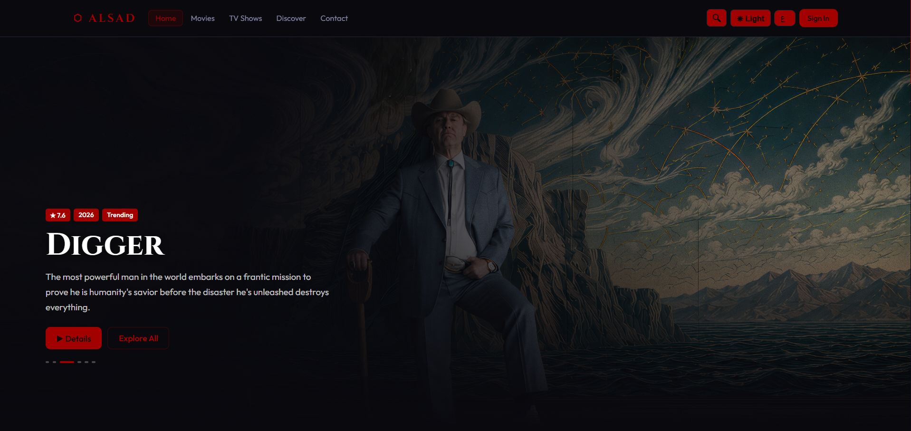
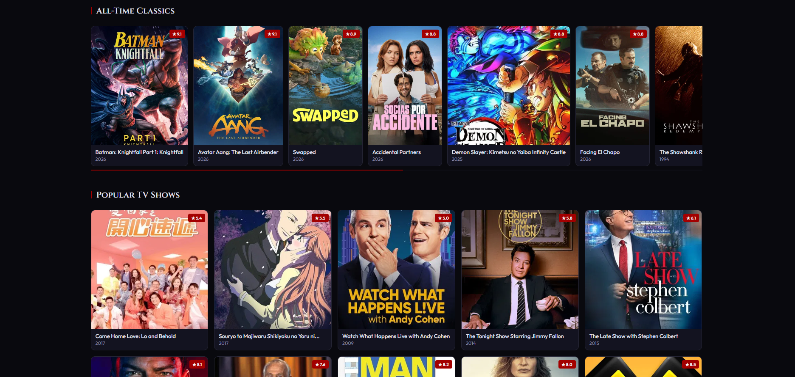
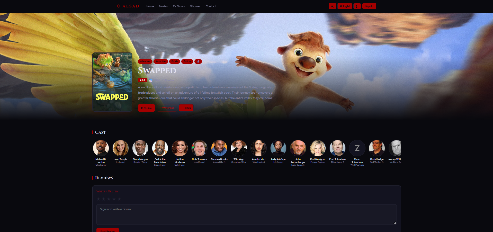
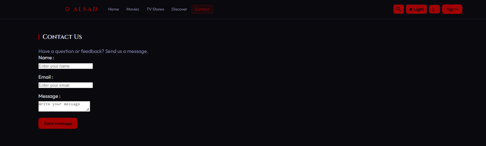
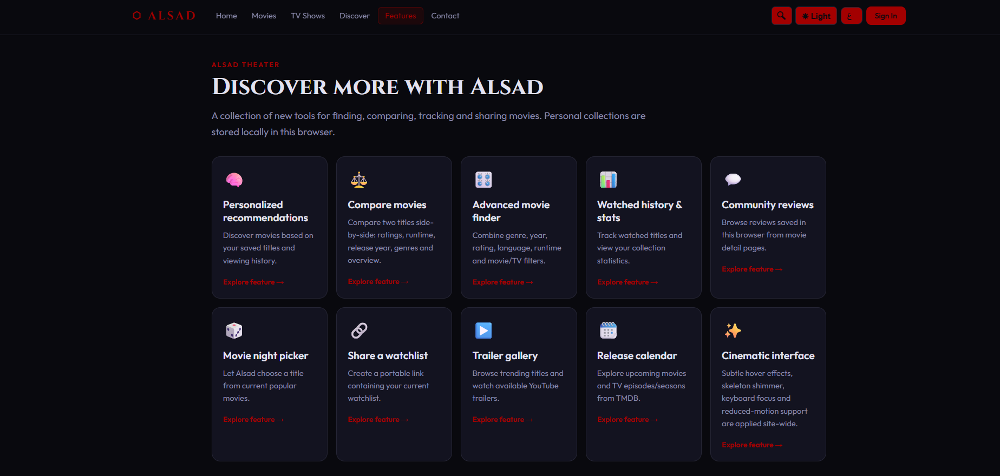

# ALSAD Theater

## Project Description

ALSAD Theater is a React-based movie discovery web application designed to help users explore movies and TV shows in an easy and interactive way.

The application uses dynamic movie and TV show data from The Movie Database (TMDB) API. Users can search for movies and actors, view detailed information, explore actors, manage their watchlist, and interact with different features of the website.

The project is designed with a responsive interface that works across desktop, tablet, and mobile devices.

The application also includes an additional Features page with tools for personalized recommendations, movie comparisons, advanced filtering, viewing statistics, community reviews, watchlist sharing, trailer browsing, and release tracking.

## Features

* Browse Movies
* Browse TV Shows
* Discover Movies and TV Shows
* Search for Movies and Actors
* View Movie Details
* View Actor Details
* Add and Remove Movies from Watchlist
* User Login Interface
* Contact Form
* Form Validation
* Dark / Light Mode
* Arabic / English Language Support
* Movie Categories and Genres
* Pagination
* Movie Filtering and Sorting
* Reviews and Ratings
* Trailer Viewing
* Loading States
* Error Handling
* Empty States
* Responsive Design
* Toast Notifications
* Local Storage for User Data and Watchlist
* Navigation between pages using React Router

### New Features

The Features page introduces 10 additional tools to improve the movie discovery experience:
- **Personalized Recommendations:** Discover movies based on saved titles and viewing history.
- **Compare Movies:** Compare two movies side by side, including ratings, runtime, release year, and genres.
- **Advanced Movie Finder:** Filter movies and TV shows by genre, year, rating, language, and runtime.
- **Watched History & Stats:** Track watched titles and view personal collection statistics.
- **Community Reviews:** Browse reviews saved in the browser from movie detail pages.
- **Movie Night Picker:** Choose a movie randomly from currently popular titles.
- **Share a Watchlist:** Create a shareable link containing the current watchlist.
- **Trailer Gallery:** Explore trending titles and watch available YouTube trailers.
- **Release Calendar:** Explore upcoming movies and TV episodes or seasons using TMDB data.
- **Cinematic Interface:** Enjoy hover effects, skeleton loading animations, keyboard focus indicators, and reduced-motion support.

## Technologies Used

* React Router
* React
* JavaScript
* Vite
* CSS3
* TMDB API
* LocalStorage
* Git
* GitHub

## React Concepts Used

The project demonstrates several important React concepts, including:

* Components
* Props
* State
* Event Handling
* Conditional Rendering
* Lists and Keys
* Forms
* `useState`
* `useEffect`
* Dynamic Data Fetching
* React Router

## Team Members

* Areej Al-Tobasi
* Abdullah Qubbaj

## How to Run the Project

### 1. Clone the Repository

```bash
git clone https://github.com/abdullah2776/Alsad-Theater.git
```

### 2. Open the Project Folder

```bash
cd Alsad-Theater
```

### 3. Install Dependencies

```bash
npm install
```

### 4. Start the Development Server

```bash
npm run dev
```

### 5. Open the Application

Open the local URL shown in the terminal, usually:

```text
http://localhost:5173
```

## Screenshots

### Home Page


### Movies Page


### Movie Details Page


### Contact Page


### Features Page


## Live Demo

https://alsad-theater.netlify.app

## Repository

https://github.com/abdullah2776/Alsad-Theater


